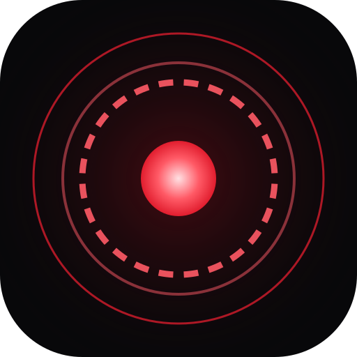
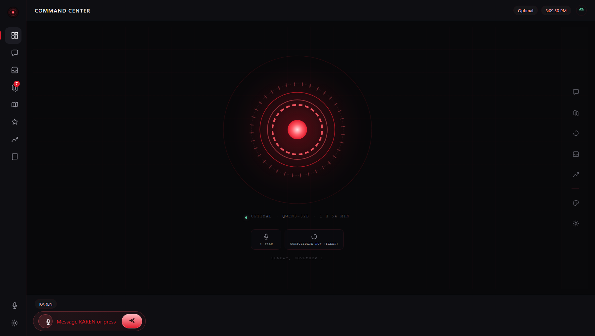
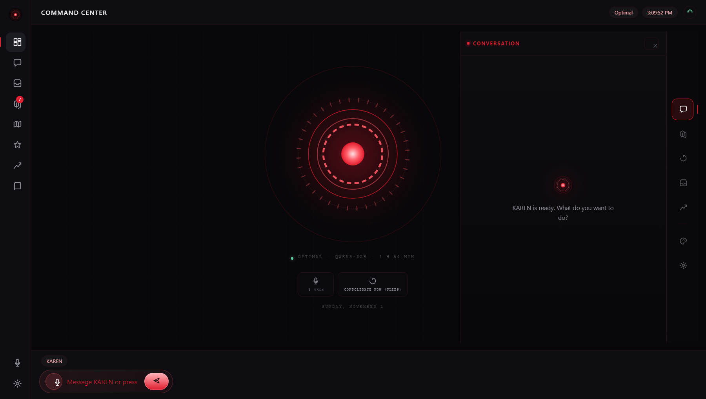
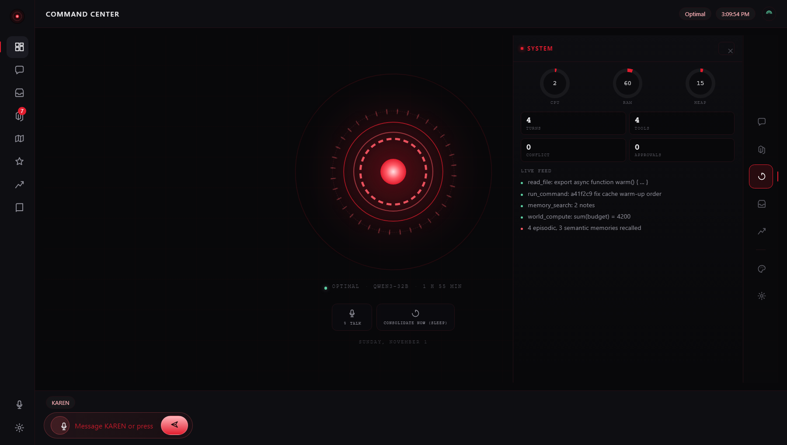
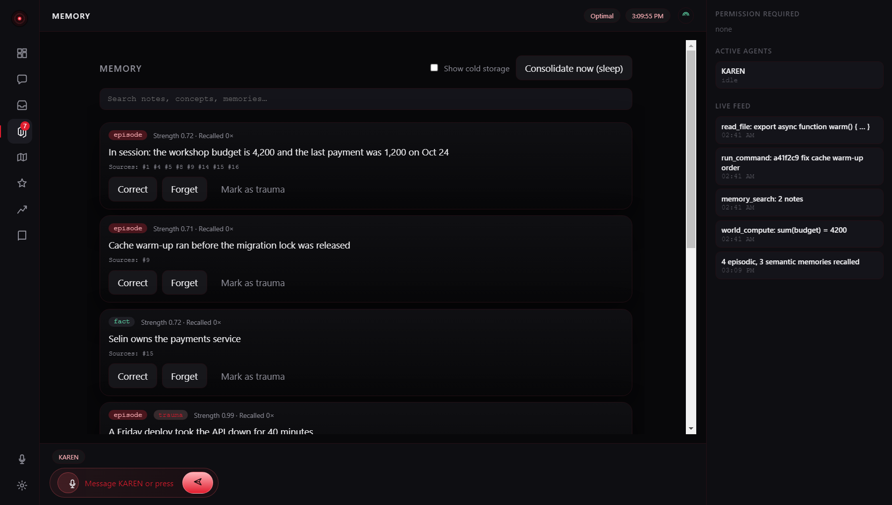
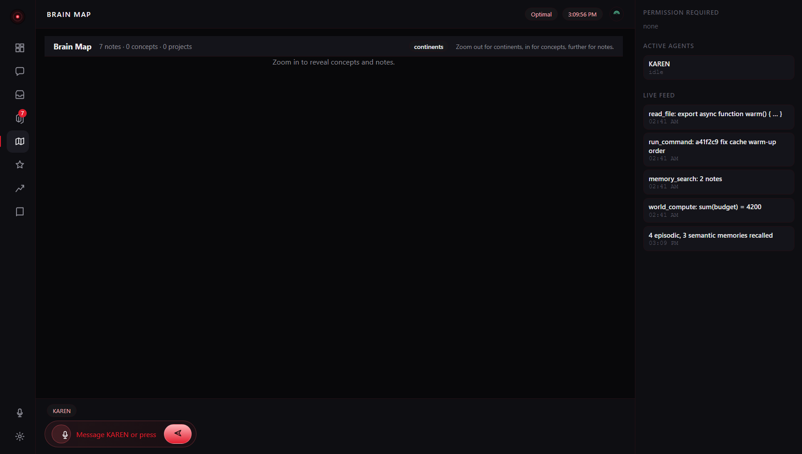
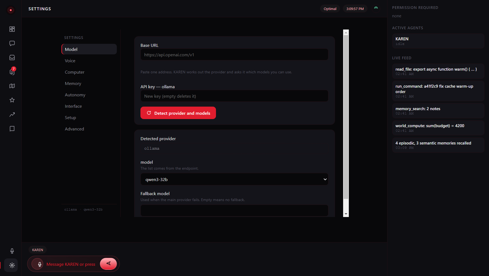

<div align="center">



# KAREN

**A local agent hub with a second brain.** · *Bilgisayarında çalışan, seni tanıyan ajan.*

<p>
  <a href="https://github.com/BrNx01/karen/actions/workflows/ci.yml"></a>
  <a href="https://github.com/BrNx01/karen/releases/latest"></a>
  <a href="LICENSE"></a>
  
  
  
  
</p>

<p>
  <a href="https://brnx01.github.io/karen/">Website</a> ·
  <a href="https://github.com/BrNx01/karen/releases/latest">Download</a> ·
  <a href="https://github.com/BrNx01/karen/issues">Issues</a>
</p>

</div>

---

KAREN runs on your machine and stays there. Not a chat box with a tool button: the
**brain** talks to you, **sessions** do the work, a **memory** that thickens with use
decides what comes back next time, and you paste **one API address** to pick a model.

```bash
git clone https://github.com/BrNx01/karen.git && cd karen
npm install && npm run build
npm run karen -- serve          # prints a tokenised 127.0.0.1 URL
```

Or install the Windows build and skip the terminal:
[**KAREN-Setup-1.2.0.exe**](https://github.com/BrNx01/karen/releases/latest).

> KAREN is an independent project. It is not affiliated with, sponsored by, or built
> from any commercial assistant; the design is its own and every screenshot below is
> this build.

## See KAREN in action

Real captures from the 1.2.0 build, taken from a seeded demo profile — no personal
memory, paths or keys appear in any of them.

| Cockpit | A panel, opened |
| :---: | :---: |
| [](docs/assets/showcase/cockpit.png) | [](docs/assets/showcase/cockpit-conversation.png) |
| **System panel** | **Memory** |
| [](docs/assets/showcase/cockpit-system.png) | [](docs/assets/showcase/memory.png) |

| Brain map | Settings |
| :---: | :---: |
| [](docs/assets/showcase/brain-map.png) | [](docs/assets/showcase/settings.png) |

## The cockpit

One screen, and almost nothing on it:

- **The core** in the middle — the mark, a tick bezel, two counter-rotating rings, the
  status line, and two actions: talk, and consolidate now.
- **A quiet dock** on the right: five small icons. An icon grows under the pointer and
  shows its name; clicking opens that panel beside the core. Click it again, or press
  `Esc`, and the panel is gone.
- **Nothing permanent.** Conversation, memory, system, inbox and agents are panels, not
  columns. The screen stays empty until you ask for something.
- **Clear screen** hides the dock too, leaving only the orb and the composer.
- **It comes to you when it matters**: a reply in flight or an approval waiting opens the
  conversation panel on its own.

Screens that need room — Memory, Brain Map, Skills, Growth, Repos, Settings — stay whole
pages on the rail.

## Download and use

- **[Windows installer](https://github.com/BrNx01/karen/releases/latest/download/KAREN-Setup-1.2.0.exe)** —
  run it, open KAREN. It updates itself from then on.
- The installer is **unsigned**, so Windows warns about an unknown publisher:
  *More info → Run anyway*. Code signing removes that warning.
- **First run does the setup for you**: it downloads the offline speech engine and two
  voices (~180 MB, resumable, skippable), then asks for one API address. Nothing else is
  manual.
- **Coming from 1.0.0?** KAREN copies the old profile — memory, event log, settings,
  keys — and leaves the original folder untouched.

## One address, then models

Settings → **Model**:

1. Paste an address (`https://evren-llmapi.ssyz.org.tr/v1`, `http://127.0.0.1:11434/v1`,
   `api.openai.com/v1` — a bare host works too).
2. Paste the key, if the provider needs one.
3. Press **Detect**. KAREN works out the protocol (OpenAI-compatible, Anthropic or
   Google), asks the endpoint which models that key can use, and lists them with their
   context size.
4. Pick a model. A fallback model covers the case where the main provider errors.

Local addresses default to `http`, everything else to `https`. Two different custom
endpoints are stored separately, so their keys never overwrite each other.

| | |
|---|---|
| Local, no key | Ollama · LM Studio · llama.cpp · vLLM |
| Cloud | Anthropic · OpenAI · Google · Groq · Cerebras · DeepSeek · Mistral · OpenRouter · Together · xAI · Fireworks · Perplexity · Azure · **EVREN (SSB)** |
| Anything else | any OpenAI-compatible endpoint |

Keys go to `~/.karen/secrets.json` (never shown again) or are read from
`ANTHROPIC_API_KEY` / `OPENAI_API_KEY`. **With no key at all KAREN falls back to a local
model** — it never refuses to start.

## Voice

KAREN speaks with a **female neural voice that runs offline**: Piper on your CPU, two
voices shipped (`tr_TR-dfki-medium`, `en_GB-alba-medium`), speed adjustable, cached so
the same sentence is not synthesised twice. Recognition is local whisper; your audio
only ever reaches `127.0.0.1`.

```bash
npm run karen -- voice-setup --yes    # same download, from the terminal
```

Say **“hey karen”** to wake it (off by default: some browsers run speech recognition in
the cloud). The interface switches between English and Turkish instantly; KAREN still
answers in whatever language you write in.

## It can use the computer

Not "run this shell command" — actual input, on Windows, behind one switch:

| Tool | What it does |
|---|---|
| `mouse_move` · `mouse_click` · `scroll` | point, click, wheel |
| `type_text` · `press_keys` | type (Turkish letters included), press `ctrl+shift+t` |
| `window_list` · `window_focus` | find a window, bring it forward |
| `ui_tree` · `ui_invoke` | read the accessibility tree, click an element by name |

Settings → **Computer** has three modes:

- **Off** — the tools are not even offered to the model.
- **Ask** (default) — every action is an approval card showing the coordinates and the
  target window.
- **Allow** — input goes through without a card, *except* typing anything that looks like
  a credential, and closing or moving a window.

Guard rails: `Ctrl+Alt+K` stops KAREN from anywhere (it lives in the main process, so it
works with the window hidden), every action is written to the event log, autonomous
sessions never get these tools, and a turn is cut after 30 input actions.

## Memory

Layered the way recall actually behaves:

- **Working context → episodes → facts → skills → cold storage.**
- **Dual strength:** storage never decreases, retrieval fades; the FSRS curve decides
  when a note surfaces.
- **Hebbian links:** two memories recalled in the same turn thicken their link; unused
  links thin over a 30-day half-life and are never deleted.
- **Intuitions:** old, well-consolidated notes add a one-line weight hint (concepts,
  confidence, caution, source ids) instead of more prose.
- **Evidence rule:** a distilled note must cite the event ids that support it. No
  citation, no note. Secrets are never written.
- **Trauma never cools:** a trauma-marked note never goes dormant and its strength never
  falls below the floor. The mark comes from deterministic detection or your approval,
  never from the model.

## Autonomy

Off until you turn it on (Settings → Autonomy). When you have been idle past the
threshold, KAREN opens a **restricted** session: read-only tools, network reads only, no
approval requests, nothing installed or executed. It distils what it learned in the same
tick and leaves exactly one inbox line. Closing the app stops all of it.

## Safety model

- Server bound to `127.0.0.1`, token required, Origin checked.
- **Permission gate:** reads are free, writes stay inside the project root; deletion,
  network, interpreters, `git push` and command chaining ask first.
- An **unknown** command always asks. The model's opinion that it is harmless does not
  count.
- Automatic approvals are logged and labelled "approved by the brain" in the interface.
- **Core identity is read-only**: edits are reverted on load, and the self-improvement
  system cannot even propose changes to it.
- Protected surfaces (permissions, approval path, settings, tests, shell) can never be
  proposed; a change is compiled and tested in a temp copy before it reaches you, and
  lands as one revertible commit.

## Architecture

```text
server/
  engine/        agent loop, tools, provider adapters + probe, permission classifier
  memory/        layers (FSRS), distillation, sleep, world model, map
  brain/         state vector, preferences, reflex (amygdala), read-only core
  autonomy/      idle clock, DMN scheduler, drives, inbox, shadow mode
  computer-*     input policy (off / ask / allow) and the 30-action cap
  store/         append-only event log (hash chain)
  http/          HTTP + WebSocket, approval broker, localisation
  voice/         local whisper, Piper engine, resumable install
  growth/        self-improvement proposals
shared/i18n/     one dictionary for the interface and the server
app/             React interface (Vite): rail, stage, context panel, palette
electron/        desktop shell, updater, arc-reactor icon
site/            landing page (GitHub Pages)
docs/            design records, plans, screenshots
```

## Development

```bash
npm test               # 878 tests
npx tsc -p tsconfig.json --noEmit
npm run build          # server + interface
npm run desktop        # run in Electron
npm run dist           # Windows installer → release/
npm run icon           # regenerate the mark (one geometry source)
```

Screenshots: seed a demo profile, serve it, then capture from Electron's offscreen
renderer — no visible window, no real data.

```bash
node scripts/demo-profile.mjs "$TEMP/karen-demo"
node dist/server/cli.js serve --port 7474 --data "$TEMP/karen-demo" --root .
```

Releasing: bump `version`, `git tag v1.2.0 && git push --tags`. CI builds the installer,
rebuilds the native module for Electron, and publishes it; installed apps pick the update
up by themselves.

## Documentation

- [Design records and plans](docs/superpowers/) — how each phase was built and why
- [Glossary](docs/GLOSSARY.md) — the terminology the code and docs use
- [Changelog](CHANGELOG.md) — what shipped in each release

## Contributing

Open an [issue](https://github.com/BrNx01/karen/issues) for bugs and ideas. Keep a change
focused, run the tests, and say what you verified.

## License

[MIT](LICENSE). KAREN is released by its contributors, with no warranty — an agent that
can move your mouse and type into your windows is a tool, and the permission gate is
there to be read.
